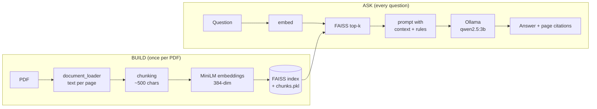

# Local PDF RAG

Ask questions about any PDF and get answers grounded in its text, **with page citations**.
Everything runs on your own machine: no API keys, no cloud calls, no data leaves your computer.


## Features

- **Fully local**: MiniLM embeddings, FAISS search, and a small LLM served by Ollama.
- **Page-level citations**: every answer lists the pages and similarity scores of the chunks it used.
- **Two chunking strategies** (sliding window and recursive) that you can compare with the built-in evaluation.
- **Evaluation harness**: Hit@k, MRR, page hit, keyword recall, citation rate, and refusal rate on questions the document cannot answer.
- **Simple CLI**: `build`, `ask`, `chat`, and `eval` commands.

## How it works



Retrieval uses cosine similarity (normalised vectors with an inner-product index). The prompt tells the model to answer **only** from the retrieved context, to cite page numbers, and to say so when the answer is not in the document.

## Project structure

```
.
├── main.py                  # CLI entry point
├── requirements.txt
├── src/
│   ├── document_loader.py   # extracts text per page (keeps page numbers)
│   ├── chunker.py           # recursive splitter (LangChain, 500 / 50)
│   ├── embeddings.py        # embedding demo script
│   ├── vector_store.py      # chunks, embeds, writes the FAISS index
│   ├── retriever.py         # embeds a question, returns top-k chunks
│   ├── rag.py               # builds the prompt and asks the LLM
│   └── llm.py               # plain LLM call without retrieval (for comparison)
├── evaluation/
│   ├── questions.json       # your question set (create it, see Evaluation)
│   └── rag_eval.py          # scoring script
├── data/documents/          # put your PDF here (not tracked by git)
└── vectorstore/             # generated index (not tracked by git)
```

## Requirements

- Python 3.11 or newer
- [Ollama](https://ollama.com/download) installed and running
- About 3 GB of free disk space (PyTorch, the embedding model, and the LLM)

## Setup

```bash
git clone https://github.com/Harsha-r0305/local-pdf-rag.git
cd local-pdf-rag
```

**Windows (PowerShell)**
```powershell
py -3.11 -m venv venv
.\venv\Scripts\Activate.ps1
pip install -r requirements.txt
```

**Linux / macOS**
```bash
python3 -m venv venv
source venv/bin/activate
pip install -r requirements.txt
```

Download the language model:
```bash
ollama pull qwen2.5:3b
```

The first run also downloads the `all-MiniLM-L6-v2` embedding model from Hugging Face, so you need an internet connection once.

## Usage

### 1. Add your document

Place your PDF at `data/documents/paper.pdf` (the filename is set by `PDF_PATH` in `src/vector_store.py`).

### 2. Build the index

```bash
python main.py build                       # default: sliding-window chunks
python main.py build --splitter recursive  # word-safe chunks
```

### 3. Ask questions

```bash
python main.py ask "What is the main contribution of this paper?"
python main.py ask "What datasets were used?" --top-k 8
python main.py chat                        # interactive, type 'exit' to quit
```

Example output:

```
AI: The paper proposes ... (page 2). Results show ... (page 7).

Sources used (page, similarity):
  - paper.pdf  p.2  score=0.647
  - paper.pdf  p.7  score=0.529
```

## Chunking strategies

| Strategy | Flag | Behaviour |
|---|---|---|
| Sliding window | `--splitter sliding` (default) | Fixed 500-character windows with 100 overlap. Fast, but can cut mid-word. |
| Recursive | `--splitter recursive` | Splits on paragraphs, lines, and whitespace first, so it never cuts mid-word. |

Build with each one, run `python main.py eval`, and compare the numbers on your own document.

## Evaluation

```bash
python main.py eval               # retrieval metrics only (fast, no LLM)
python main.py eval --generate    # also scores generated answers (Ollama must be running)
python main.py eval --k 10        # change how many chunks are retrieved
```

| Metric | Meaning |
|---|---|
| **Hit@k** | A correct chunk appears in the top-k results |
| **MRR** | How high the first correct chunk is ranked (1.0 is best) |
| **PageHit@k** | Looser: any chunk from the right page appears in the top-k |
| **Keyword recall / citation rate** (`--generate`) | Does the answer contain the expected facts and cite a page |
| **Refusal rate** (`--generate`) | On unanswerable questions, does the model decline instead of inventing an answer |
| **Top-1 similarity gap** | Answerable vs unanswerable questions; a large gap suggests a minimum-similarity cutoff would work |

Results are written to `evaluation/results.json`.

### Writing your own question set

`evaluation/questions.json` is a list of entries. It is not included in the repo, so **create it with questions about your own PDF**:

```json
{
  "id": "Q01",
  "type": "factual",
  "question": "How many records were used in the evaluation?",
  "gold_pages": [6, 7],
  "retrieval_keywords": ["2,060"],
  "answer_keywords": ["2,060"]
}
```

- A chunk counts as correct if it is on one of the `gold_pages` **and** contains at least one `retrieval_keyword`.
- Use `"type": "unanswerable"` with empty lists for questions the document cannot answer (for example, a trivia question). These measure refusal behaviour.

## Configuration

| What | Where |
|---|---|
| LLM model | `MODEL_NAME` in `src/rag.py` and `src/llm.py` |
| Embedding model | `MODEL_NAME` in `src/vector_store.py`, `src/retriever.py`, `src/embeddings.py` |
| Chunk size / overlap | `CHUNK_SIZE`, `CHUNK_OVERLAP` in `src/vector_store.py`; `src/chunker.py` for the recursive splitter |
| Number of retrieved chunks | `--top-k` flag (default 6) |
| PDF path | `PDF_PATH` in `src/vector_store.py` |

If you change the embedding model, rebuild the index.

## Troubleshooting

| Problem | Fix |
|---|---|
| `Activate.ps1` not found on Windows | Your `python` may be MSYS2 or the Microsoft Store shortcut. Create the venv with `py -3.11 -m venv venv`. |
| PowerShell blocks the activate script | Run `Set-ExecutionPolicy -Scope CurrentUser -ExecutionPolicy RemoteSigned` once. |
| `Could not reach Ollama` | Start the Ollama app, or run `ollama serve` in another terminal. |
| `model not found` | Run `ollama pull qwen2.5:3b`. |
| `No vector index found` | Add a PDF to `data/documents/` and run `python main.py build`. |

## Limitations

- One PDF at a time; scanned PDFs without a text layer produce no text (no OCR).
- A 3B model can miss details or paraphrase loosely on long or technical passages. Try a larger Ollama model by changing `MODEL_NAME`.
- Tables and figures are only retrieved if their text survives PDF extraction.
- `chunks.pkl` is loaded with `pickle`. Only load index files that you built yourself.

## License

Released under the [MIT License](LICENSE).
